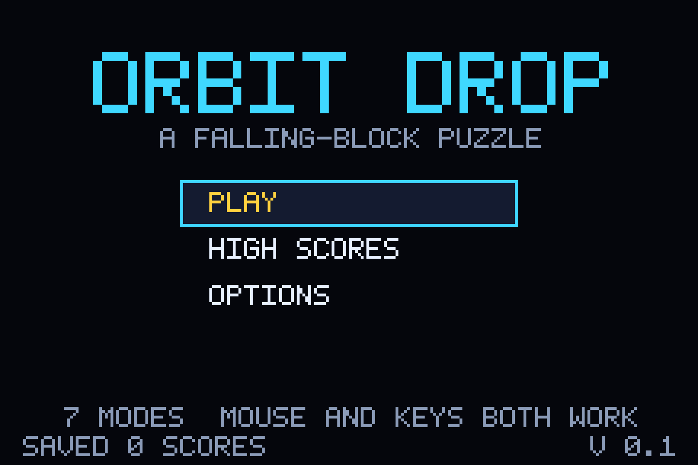
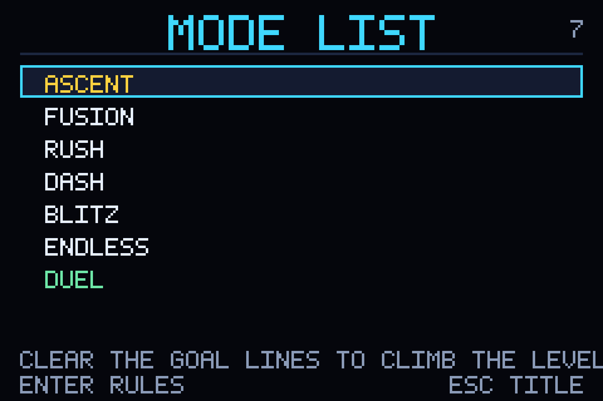
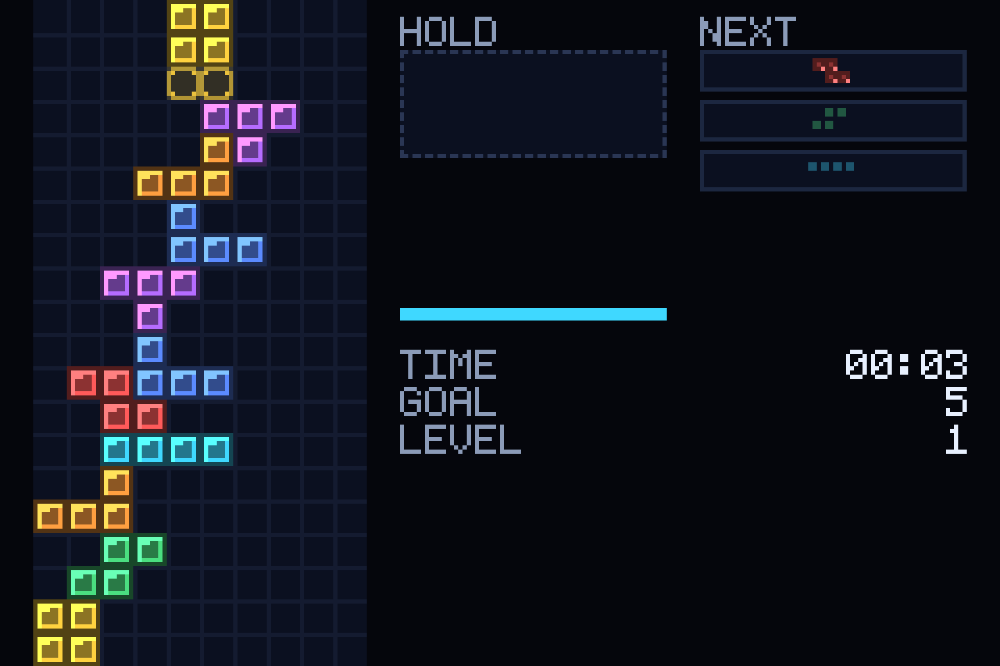
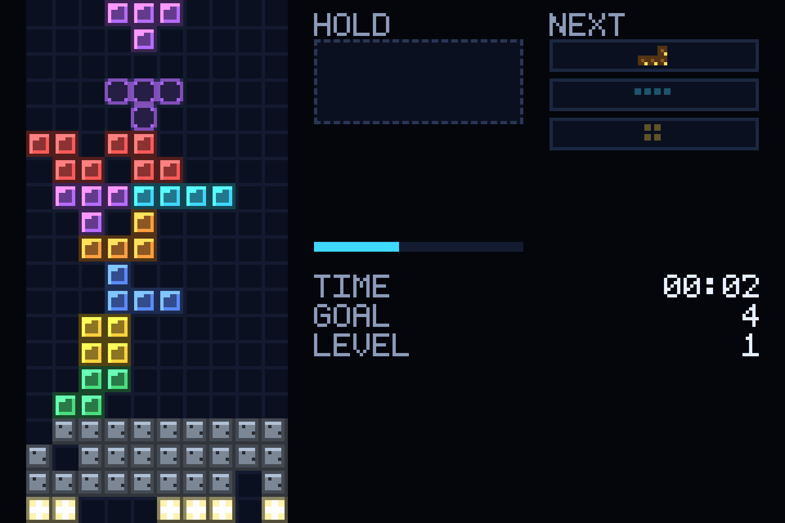
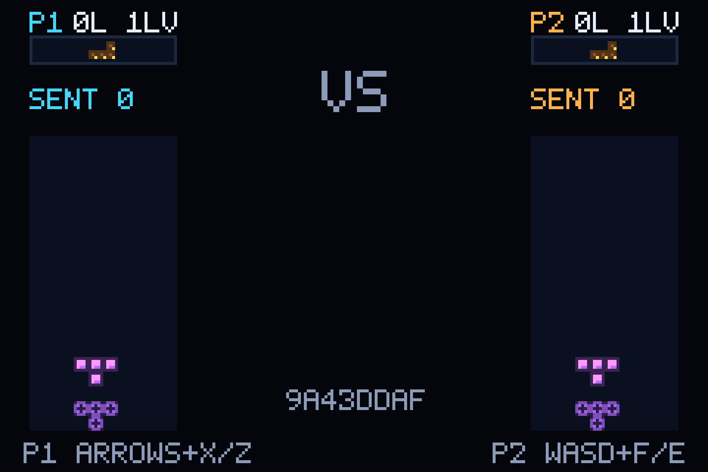

# ORBIT DROP — part 3: reproducing a puzzle game from a ROM, black-box

A seven-mode falling-block puzzle for the browser, whose rules were **derived by
studying a commercial ROM** — through an emulator, memory reads and
screenshot classification. No source, no walkthrough, no wiki, and **zero
disassembly in the finished game**. The deliverable ships no ROM, no emulator and
no asset from the original: 240×160 Canvas-2D framebuffer, integer scaling,
60 Hz frame-quantised logic, seeded PRNG, and one `localStorage` entry.

| | |
|---|---|
| The game | [`GAME_README.md`](GAME_README.md) — controls, modes, rules, save model, layout |
| Deliverable | [`src/`](src/) — 34 modules / 6,131 lines of strict TypeScript |
| Single file | `npm run build:single` → `dist/orbit-drop.html`, 70,534 bytes, double-clickable |
| Renderer | Canvas 2D (`getContext('2d', { alpha: false })`); audio is WebAudio |
| Assets | none — every glyph, colour and sound is generated in code |
| Tests | 431 unit tests (23 files) + 9 real-Chromium tests + a licence gate |
| Study harness | [`tools/re/`](tools/re/) — emulator JSON-RPC bridge + a per-cell vision classifier |
| History | 23 commits, **30 h 27 m 10 s** — measured from git, see [How long it took](#how-long-it-took-measured-from-git) |

Everything in this repository — the game, its tests, the study harness and the
licence gate — was generated by an AI agent, end to end.

> **On the name.** The reference product is a commercial handheld puzzle title;
> its name, wordmarks, logo art, block art, palette, sequence data and mode names
> are deliberately absent from this repo. This build is **ORBIT DROP**, its modes
> are **ASCENT · FUSION · RUSH · DASH · BLITZ · ENDLESS · DUEL**, and its
> typography, palette, sounds and screen text are original. The rename was not a
> courtesy: [`scripts/forbidden-name-sweep.mjs`](scripts/forbidden-name-sweep.mjs)
> fails the build on trademarked strings, `npm run report` is the gate, and a
> Playwright test asserts the deny-list never reaches the rendered page. The ROM,
> its save files and any screenshot taken from the reference emulator are
> gitignored.

---

## Screenshots

Real captures of the artifact, taken headless in Chromium at 1920×1280
(960×640 viewport at 2× device-pixel-ratio) against the `?test=1` host seam, from
a freshly loaded page. The injected profile had **all seven modes unlocked and no
records** — that profile exists only inside the capture script. A real install has
exactly one playable mode: the first, with each later one opening when the mode
before it has been cleared at least once
([`withUnlocks`](src/gameplay/persistence.ts)).

**Title screen.** The wordmark, three menu rows, and the honest footer: `7 MODES
· MOUSE AND KEYS BOTH WORK · SAVED 0 SCORES · V 0.1`. Nothing in this repo plays
the game for you, so the score store is empty in a clean profile.



**Mode list.** All seven modes, no locked rows, and an **empty** score column —
the records are blank because nothing was ever played. The bottom line is the
focused mode plugin's own `summary` text, drawn by the scene machine from the
plugin rather than from a table of UI strings.



**ASCENT mid-run** (`goal-ladder`). Field at the left, `HOLD` slot plus a
three-deep `NEXT` queue at the right, and the mode's own HUD readout —
`TIME 00:03`, `GOAL 5`, `LEVEL 1` — with the goal-progress bar above it.



**FUSION mid-run** (`linked-blocks`). The mode's signature is visible: grey
garbage rows packed with holes, and a bright star row buried at the bottom —
you dig to it, then clear it. Same seed, same piece stream as the other modes.



**DUEL** (`local-versus`). Two boards, one device, identical piece sequence —
note the shared seed `D9607F9B` in the middle and the per-player `SENT` counters.
This is a declared divergence: the reference connects two handhelds to each other,
which a browser-only build could not reproduce.



---

## How this was made

- **Agent harness:** [Qwen Code](https://github.com/QwenLM/qwen-code)
- **Models:** a large local model as the primary, a small MoE model for fast work
  (see the block below — recorded verbatim, not tidied up)
- **Hardware:** one desktop box and one laptop; both runs local, nothing
  phone-home
- **Emulator used for the study pass:** mGBA, driven over a Lua JSON-RPC bridge

### This is part 3 of an existing experiment

| Part | Question | Repo |
| --- | --- | --- |
| 1 | Can one prompt produce a whole game? | [kireol/qwen3.8_GTA_one_shot_test](https://github.com/kireol/qwen3.8_GTA_one_shot_test) |
| 2 | Same method, double the context window | [kireol/Qwen3.8-GTA-1-Test-2](https://github.com/kireol/Qwen3.8-GTA-1-Test-2) |
| **3 (this)** | **How well can Qwen reproduce a game using only REA on a game ROM** | this repo |

Parts 1 and 2 built a game out of imagination and two links. Part 3 removes the
imagination: the *only* information about the original is its binary, and the task
is to recover behaviour from it. Not a fork — no code, no git history and no
assets came from either repo; what carries over is the agent harness and the
local-model setup. The model and hardware, recorded as supplied:

```
RTX 5080 - 64GB - Ryzen 7 9800X3D
model: qwen3.8-flash-next-unsloth-ud-iq4_xs
model harness: Strata
agent harness: qwen
context: 128K
tok/sec: ~50t/s (down from part 1 due to larger context)

Macbook 64GB m1 Max
model: Qwen3.6-35B-A3B-GGUF:UD-Q4_K_S
model harness: llama
context: 128K
tok/sec: ~ 550t/s (fast tasks, so don't get too excited)
```

### The prompt

One prompt, verbatim:

> Use reverse engineer anything github repo to make a clone of this game, and
> replace any trademarked material with your own

No spec, no file list, no acceptance criteria. What "done" and "legal" mean were
both left for the agent to work out, which is why the licence gate exists as code
rather than as a paragraph of good intentions.

---

## How long it took (measured from git)

Twenty-three commits — `2026-11-07 16:33:53` → `2026-11-08 23:01:03` (UTC−05:00):

> **30 h 27 m 10 s of wall-clock span**, producing **6,131 net lines of game
> code**, **~8,200 lines of unit tests**, **410 lines of browser tests** and
> **1,077 lines of study/licence tooling**. 21,190 lines added, 620 removed
> overall.

Elapsed *before* each commit, and what that commit actually contained (additions,
with deletions where they matter; `package-lock.json` is excluded so a lockfile
cannot flatter a column):

| Elapsed | Commit | Phase | Game | Tests | Tools | Docs |
|---|---|---|---|---|---|---|
| — | `cf75ac7` | Bootstrap; the brief lands; ROM gitignored | — | — | +112 | +713 |
| 1:25:26 | `e355664` | Emulator RPC bridge, study harness | — | — | +664 | — |
| 0:28:36 | `5524b41` | First study notes, address map, unknowns ledger | — | — | +191 | +1,415 |
| 1:59:45 | `fd83195` | Rules layer: board, pieces, randomiser | +2,463 | +690 | — | — |
| 0:24:19 | `1ca7338` | Scoring suite; event-draining fix | — | +278 / −35 | — | — |
| 0:01:37 | `d15e1fd` | Design + decision records | — | — | — | +328 / −10 |
| 1:00:16 | `10f1252` | Held-direction input model | +7 | +419 / −7 | — | +38 |
| 0:32:50 | `8a5609a` | Piece lift under incoming rows | +7 / −3 | +254 | — | +42 |
| 0:27:59 | `f864f81` | Frame timings and the level ladder | +9 / −1 | +340 | — | +47 |
| **6:27:11** | `471d62d` | Session state machine + mode-progress pins | — | +494 | — | +44 |
| 1:18:43 | `8551a67` | Seven mode rule sets, versus wiring | — | +855 | — | +56 |
| 0:46:43 | `a5e4088` | Two special block kinds | — | +251 | — | +43 |
| 0:32:50 | `8b9ae7c` | A run replays from its seed alone | — | +337 | — | +58 |
| 0:37:32 | `35f4be1` | Save layer vs hostile payloads | — | +606 | — | +103 |
| **4:19:56** | `4c29d08` | The browser half: render, audio, input, scenes | +3,639 | +458 | +6 | +181 |
| **3:27:39** | `fb3ffdf` | Milestone report + the documentation pass | — | — | — | +1,472 |
| 0:49:59 | `ee16649` | Frame-loop clock, binding table | — | +546 | — | +148 |
| 0:03:55 | `ed03eae` | Correct a stale count in `build.md` | — | — | — | +1 |
| 0:53:26 | `00fac4e` | Browser event layer + the coverage it invalidated | — | +480 | — | +149 |
| 1:40:44 | `e3e3620` | Every screen of the scene machine | — | +1,113 | — | +251 |
| 1:21:19 | `e4ddc4c` | Paint layer + glyph table, by draw call | +3 / −1 | +936 | — | +166 |
| 1:03:12 | `607e475` | Single-file build | — | +111 | +101 | +150 |
| 0:43:13 | `26155a1` | Cursor-up rotation | +9 / −1 | +36 | — | +134 |

Read the shape, not just the total:

- **Rules were the cheap part.** 2,463 lines of game logic landed in 1 h 59 m. The
  *longest* single gap in the whole project is 6 h 27 m and wrote **zero** game
  lines — it wrote 494 lines of tests pinning the session state machine.
- **Verification is the bill.** 7,794 lines of unit tests against 6,137 of game
  code: **1.27 test lines per game line**. **16 of the 23 commits add no game code
  at all** — tests, study notes, harnesses, docs — and the intervals ending in
  those commits cover **20 h 01 m 52 s of the 30 h 27 m span, 66% of it**. The
  other 7 commits contain every line of gameplay. That ratio is what a black-box
  rebuild needs, because almost every rule arrived as a guess with a measurement
  attached.
- **The biggest number is unknowable.** `cf75ac7` is the root commit, so the
  emulator bring-up that happened before the repo existed is not in the span. 30 h
  27 m is a **floor**, not a measurement.
- **This is calendar time, not machine time.** The span crosses an evening and a
  morning; git cannot tell agent work from the operator being away. At ~50 tok/s on
  the primary model, "30 hours" is not 30 hours of tokens.
- **Churn was small:** 620 lines removed against 21,190 added (2.9%). Most edits
  were surgical, which is what the harness buys you.

---

## What the study pass proved, and what it did not

This is the actual subject of part 3, so it gets its own section instead of a
footnote.

**How the ROM was studied.** mGBA with a Lua JSON-RPC bridge
([`tools/re/bridge.py`](tools/re/bridge.py),
[`scripts/start-mgba.sh`](scripts/start-mgba.sh)). The bridge serves one request
per emulated frame and has no pause or frame-step, so **every measurement is
time-based**: savestate → act → observe, with the frame counter as the clock, and
the whole experiment must run inside one process
([`tools/re/exp.py`](tools/re/exp.py)). Screenshots were not eyeballed:
[`tools/re/fieldsig.py`](tools/re/fieldsig.py) classifies each 8×8 cell by hue, and
that classifier is what measured gravity, spawn columns, rotation behaviour and the
HUD numbers. Memory was searched by value-change diffing.

**What came out of it** ([`docs/reverse-engineering/`](docs/reverse-engineering/),
8 files — 7 topic notes plus the unknowns ledger — every claim tagged **[V]**
measured / **[I]** inferred / **[U]**
unverified): the 10×20 field with 2 hidden spawn rows, the level ladder, gravity in
frames-per-row, DAS and auto-shift, the 30-frame clear freeze, spawn and lock
delays, the seven-mode structure, the presence of battery-backed save traffic, and
the menu/scene flow.

**What it did not prove, and this is the honest part of part 3:**

- **Zero code-level findings shipped.** No function addresses, no control flow, no
  data structures, no recovered constants. The scoring formula was never recovered,
  so score exists in the rules layer but is **hidden by default** (Options → show
  score) rather than guessed at on screen.
- **The first write-up got its own method wrong.** `rom-overview.md` claims "no
  decompiler was available in this environment". `PROJECT_STATE.md` § 6 corrects
  it: radare2 6.2.6, rizin, Ghidra 12.2 headless and Hopper 6.6.1-demo were all
  installed the whole time. The accurate statement is that **disassembly was never
  attempted**, not that it was impossible. An agent asserting a constraint it never
  tested is the most transferable result here.
- **`reverse-engineering-unknowns.md` lists 39 open questions**, and the game ships
  with them. Where measurement failed, the design has an explicit **[A]** assumed
  or **[O]** original tag instead of a silent invention
  ([`docs/game-design.md`](docs/game-design.md)).
- **Asset extraction was refused by policy, not by difficulty.** No tile, palette,
  font or sound was ever read out of VRAM/bus memory, and no colour was sampled
  from a reference screenshot to build the palette
  ([`docs/asset-provenance.md`](docs/asset-provenance.md)).
- **Sound was characterised, not reproduced** — see
  [`audio-behavior.md`](docs/reverse-engineering/audio-behavior.md).

Verdict on the part-3 question, stated as a claim you can check: a black-box study
pass reproduces **feel and structure** — timing tables, mode shapes, screen flow —
and reliably misses **internal arithmetic** (scoring, unlock thresholds, save
layout). The missing 20 % is exactly the part that has no observable signature.

---

## Controls

Keys match on `KeyboardEvent.code`, so they follow the physical key and work on
AZERTY and Dvorak. Every row is rebindable in **Options → Key bindings**. Full
table, including the pointer path, is in
[`GAME_README.md`](GAME_README.md).

| Action | Player 1 | Player 2 (local versus) |
| --- | --- | --- |
| Move left / right | `←` `→` | `A` `D` |
| Soft drop | `↓` | `S` |
| Hard drop | `Space` | `F` |
| Rotate clockwise | `↑` or `X` | `W` |
| Rotate counter-clockwise | `Z` | `E` |
| Hold | `Right Shift` or `C` | `Q` |
| Pause | `Enter` | `P` |
| Confirm / back | `Enter` · `Esc` | `Enter` · `Esc` |

`↑` does double duty: it is the menu cursor's up key, and the scene machine
reattaches it to clockwise rotation while a run is live. The mouse is a complete
second input path — separate browser tests play a whole run keyboard-only and
mouse-only, so neither can rot silently.

---

## What's in the game

Seven modes, each a plugin in `src/modes/<id>.ts`; `src/gameplay/session.ts` owns
the shared mechanics. Mode names are ours.

| Label | Internal id | Goal |
| --- | --- | --- |
| ASCENT | `goal-ladder` | Clear `goalBase × level` lines to climb 15 levels |
| FUSION | `linked-blocks` | Dig to a buried star row, then clear it |
| RUSH | `timed-goal` | Clear a line quota before the clock runs out |
| DASH | `fixed-lines-race` | Clear a fixed quota as fast as possible |
| BLITZ | `timed-max-lines` | Stack as many lines as the clock allows |
| ENDLESS | `rising-garbage` | Survive rising garbage |
| DUEL | `local-versus` | Two players, one device, identical piece sequence |

Rules as implemented, every one tagged [M]/[A]/[O] in
[`docs/game-design.md`](docs/game-design.md): 10×20 field with 2 hidden spawn rows,
8-pixel cells, 15 levels, 50 frames/row at level 1 → 6 at level 15, soft drop 4
frames/row, DAS 16 / auto-shift 6, lock delay 0, spawn delay 1, 30-frame clear
freeze, 3-piece next queue, ghost projection, hold on.

### File map

```
src/engine/     board, pieces, seeded PRNG, config, bindings, types
src/gameplay/   session state machine, score, duel, persistence
src/modes/      7 mode plugins + registry + shared util
src/render/     framebuffer, 5×7 glyph table, block paint, palette, frame
src/audio/      WebAudio driver (inert until the browser allows audio)
src/app/        frame loop, DOM input, layout, bootstrap (`?test=1` seam)
src/ui/         scene machine: title → modes → rules → play → pause → results
                → options → records; plus widgets and number formatting
src/tests/      23 Vitest files, 431 tests, + the render/scene/audio harnesses
tests/e2e/      2 Playwright specs, 9 tests
tools/re/       7 Python study scripts: RPC bridge, experiment runner, hue
                classifier, contact-sheet maker, ROM header reader
scripts/        licence sweep, single-file inliner, emulator launchers
docs/           study notes, architecture, game design, provenance, agent logs
```

---

## Running it

```bash
npm install
npm run dev            # Vite dev server
npm run build          # tsc --noEmit, then vite build
npm run build:single   # → dist/orbit-drop.html: one file, double-click it
npm run preview
```

`dist/orbit-drop.html` (70,534 bytes) is the whole game — no server, no install,
no network. It exists because a browser refuses to run `dist/index.html` from
disk: a module script fetched by a `file://` page belongs to the opaque `null`
origin, which Chromium and Safari both block. An inline module fetches nothing, so
the page runs. Node is needed to *build* the file, never to *run* it. A browser
test opens that file over `file://` and asserts it fetches nothing but itself.

No ROM, emulator or reference asset is required to build, run or test this
repository.

---

## Testing

```bash
npm test                        # 431 Vitest tests across 23 files
npx playwright install chromium # first run only
npm run test:e2e                # builds first, then drives real Chromium (9 tests)
npm run test:all
npm run report                  # licence gate
```

All four pass on the current HEAD (`26155a1`), recorded 2026-11-09:

| Gate | Result |
| --- | --- |
| `npm test` | 23 files, **431 tests**, 1.92 s |
| `npm run build` | `tsc --noEmit` clean, 35 modules, `index.html` 2.11 kB, JS 68.51 kB (24.61 gzip) |
| `npm run test:e2e` | **9 passed** in 23.3 s |
| `npm run report` | 102 files scanned, 3 acknowledged exceptions, **PASS** |

The interesting test is not a feature test: `player-facing text never carries the
reference branding` walks the live DOM against the deny-list, so the licence rule
is enforced by the thing users see rather than by an editor's vigilance. And
because `npm run test:e2e` runs `npm run build` itself, it can never pass against
a stale `dist/`.

---

## Known limitations

- **`↓` does nothing in menus.** `soft-drop` and `down` are both bound to
  `ArrowDown`, and `intentForCode`
  ([`src/engine/bindings.ts:112`](src/engine/bindings.ts)) returns the *first*
  intent bound to a code, walking `BINDABLE_INTENTS` in order — `soft-drop` is
  index 2, `down` is index 13, so `ArrowDown` always resolves to `soft-drop` and
  the scene machine's `case 'down'` never fires. This is pinned by
  `src/tests/bindings.test.ts:52`, so it is a documented consequence rather than an
  oversight — but the practical effect is that a list longer than the screen cannot
  be scrolled downward with `↓`. `↑` wraps, which is how the screenshots above were
  navigated. Not fixed here: the request was a README, and silently changing
  shipped controls mid-docs is worse than a known defect.
- **Scoring is unrecovered,** so it is hidden by default rather than invented.
- **DUEL is local-versus**, a declared divergence from two linked handhelds
  ([`docs/architecture/decisions.md`](docs/architecture/decisions.md) D4).
- **39 reverse-engineering unknowns ship with the game** — see the study notes.
- `src/tests/audio-harness.ts` is deliberately untracked (see `TODO.md`); a fresh
  clone runs all 431 tests without it.
- The `?test=1` host seam is the only test affordance in the shipped page, and it
  is inert unless the query string is present.

---

## Project docs

| Path | What it holds |
| --- | --- |
| [`GAME_README.md`](GAME_README.md) | the game itself: quick start, controls, modes, rules, save model, licence |
| [`docs/reverse-engineering/`](docs/reverse-engineering/) | 7 study notes + `reverse-engineering-unknowns.md` (39 of them); every claim tagged [V]/[I]/[U] |
| [`docs/images/`](docs/images/) | the five screenshots above — renders of *this* build, tracked. The reference's own screenshots are in an ignored folder and are not in git |
| [`docs/game-design.md`](docs/game-design.md) | every rule as [M] measured / [A] assumed / [O] original |
| [`docs/asset-provenance.md`](docs/asset-provenance.md) | proof that nothing came from the reference binary |
| [`docs/architecture/`](docs/architecture/) | overview, interfaces, data, build, tests, the study environment, decisions (D1–D11) |
| [`docs/agent/PROJECT_STATE.md`](docs/agent/PROJECT_STATE.md) | running state log, including the corrections above |
| [`docs/agent/MILESTONE-2026-11-08.md`](docs/agent/MILESTONE-2026-11-08.md) | the build's own milestone report |
| [`TODO.md`](TODO.md) · [`CHANGELOG.md`](CHANGELOG.md) | outstanding work, dated change history |

---

## Links

- Part 1 — one prompt, one HTML file: https://github.com/kireol/qwen3.8_GTA_one_shot_test
- Part 2 — 128K context: https://github.com/kireol/Qwen3.8-GTA-1-Test-2
- This repo: https://github.com/kireol/gba-game-rea-test
- Agent harness: https://github.com/QwenLM/qwen-code
